# บันทึกการตัดสินใจด้านการออกแบบ — 22 ต.ค. 2026

เกม: Never Ending Story Game (ต้นแบบแรก)

## 1. ขอบเขตต้นแบบแรก
- เล่นเดี่ยว ไม่มีเซิร์ฟเวอร์
- โค้ดแยก **สถานะคดี** กับ **การรับรู้ของผู้เล่น** ตั้งแต่ต้น เพื่อรองรับการเล่นเป็นทีมภายหลัง

## 2. สไตล์ภาพ — เลือกแบบ B
- **แบบ B (เลือก):** 3 มิติ low-poly สีพาสเทล แบบของเล่น + HUD บนหน้าจอ (สไตล์ได้แรงบันดาลใจจากแว่น AR) เส้นสีฟ้า ป้ายชี้วัตถุ ปุ่มใหญ่ด้านล่าง

  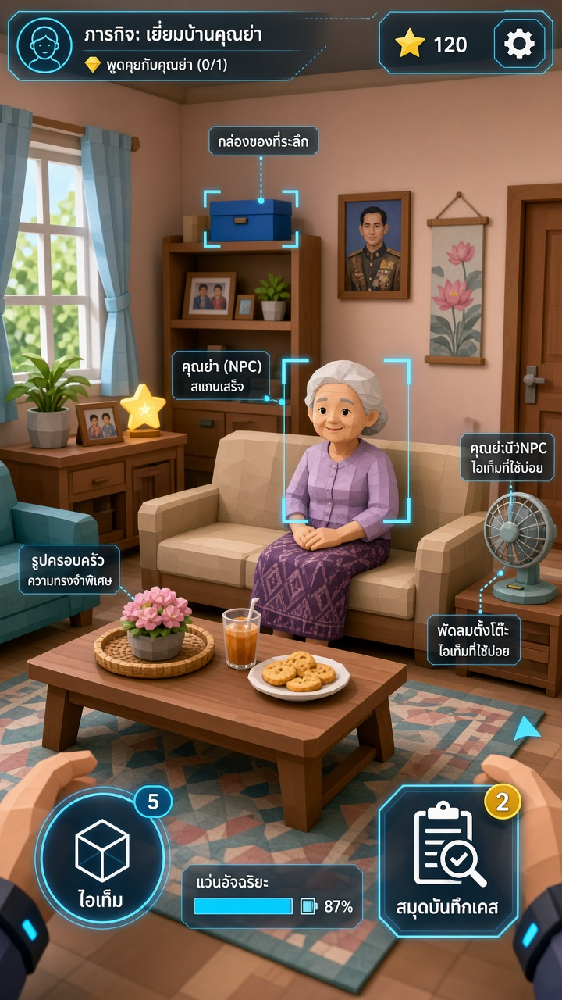

- ตัวเลือกที่ไม่เลือก: แบบ A และแบบ C

  | แบบ A (ไม่เลือก) | แบบ C (ไม่เลือก) |
  |---|---|
  | 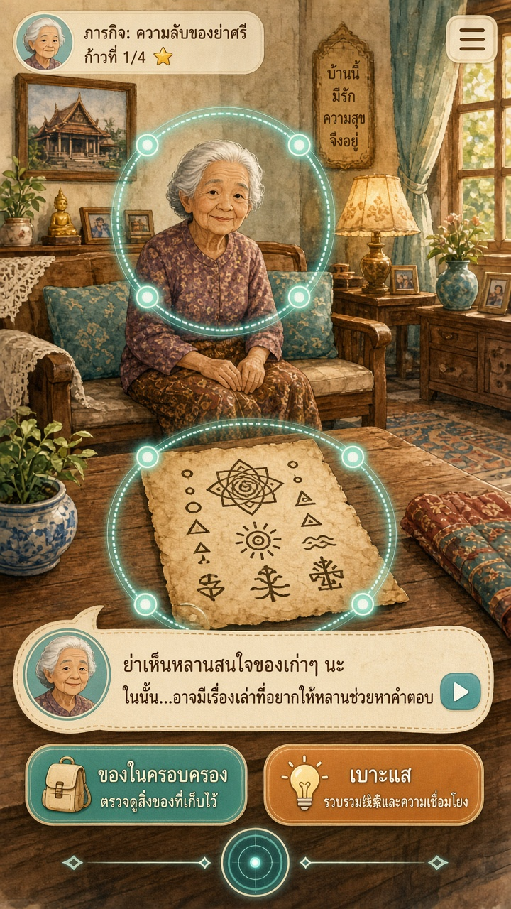 | 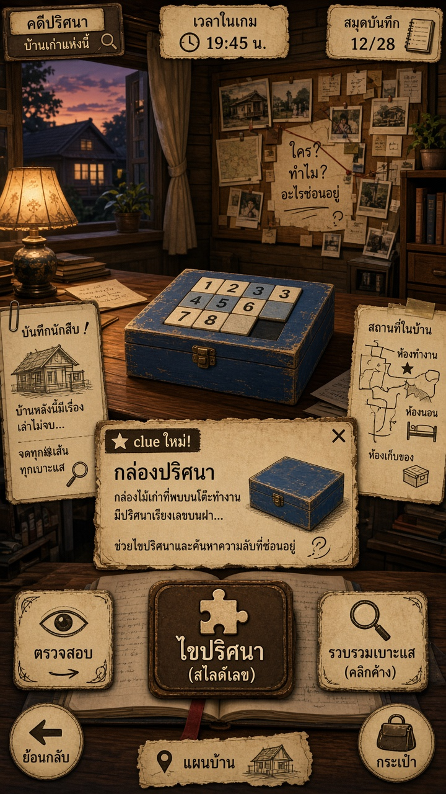 |

## 3. กล้อง
- เปลี่ยนจุดมองด้วยการตัดภาพแบบเฟดสั้น ๆ
- แต่ละห้องมีมุมกว้าง 1 มุม แตะคน/วัตถุเพื่อเฟดเข้ามุมใกล้
- ปุ่มย้อนกลับขนาดใหญ่อยู่มุมล่างซ้ายเสมอ

## 4. บ้าน 3 ห้อง + จุดกล้อง 7 มุม

> **ตัดสินใจแล้ว (อัปเดต):** จำนวนห้อง = 2–3 ห้อง ในกรอบ "เยี่ยมบ้านย่า" ตามไฟล์คดี 01 v0.2 — ห้องนั่งเล่น (จุดเริ่ม คุณยาย ลุงเมฆ ครอสเวิร์ด จิ๊กซอว์ กล่องหลอกข้างโซฟา), ห้องทำงาน (กล่องรูปดาวเป้าหมายใต้หน้าต่าง กล่องใบไม้ เลื่อนบล็อก), ครัว (ห้องเสริม ร่องรอยน้ำหก) แต่ละห้องมีมุมกว้างจากประตู 1 มุม เดินระหว่างห้องด้วยจุดแตะที่ประตูหรือแผนผังบ้าน ชุดห้องและมุมกล้องด้านล่าง (มีห้องนอนคุณยาย) เป็นข้อเสนอเดิม ภาพร่างยังใช้อ้างอิงสไตล์ได้

| ห้อง | มุมกล้อง |
|---|---|
| ห้องนั่งเล่น | 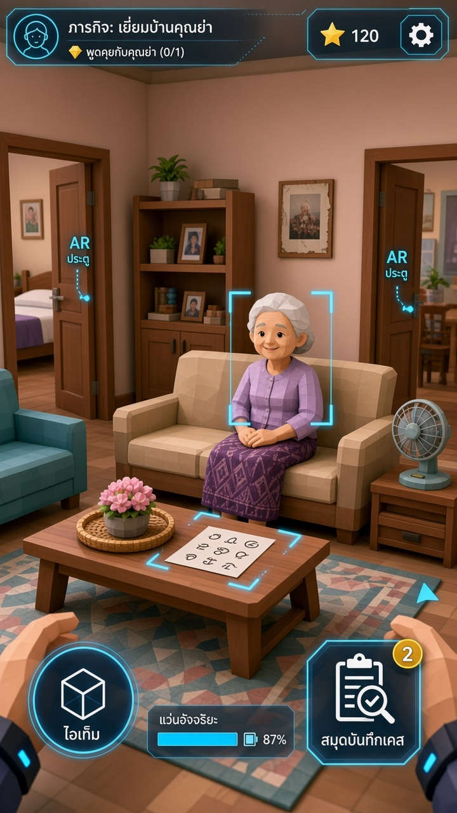 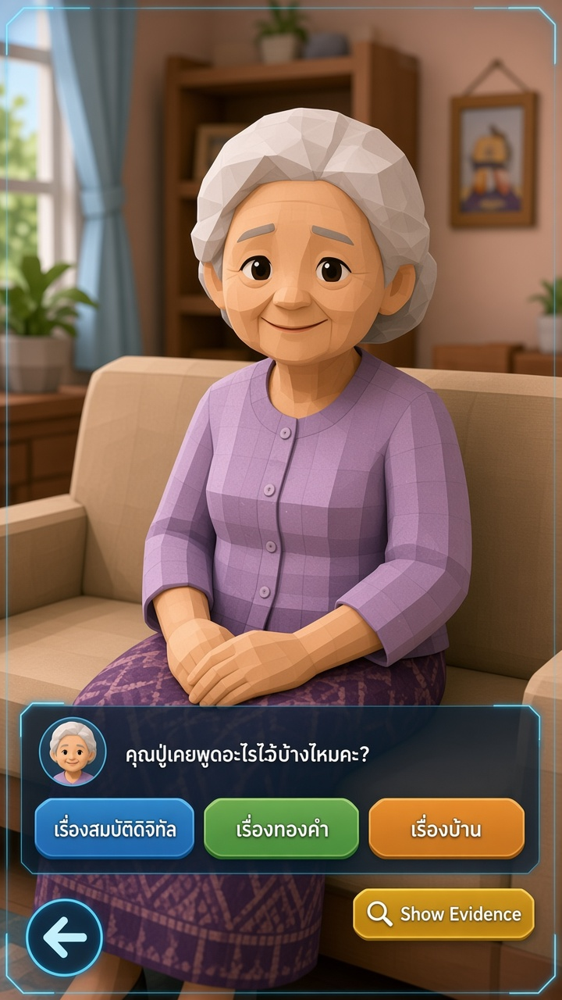 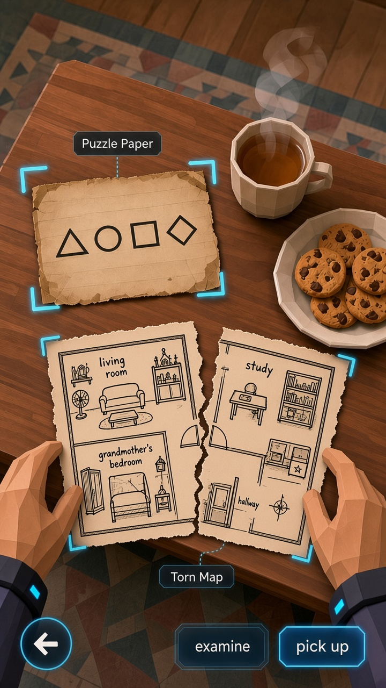 |
| ห้องนอนคุณยาย | 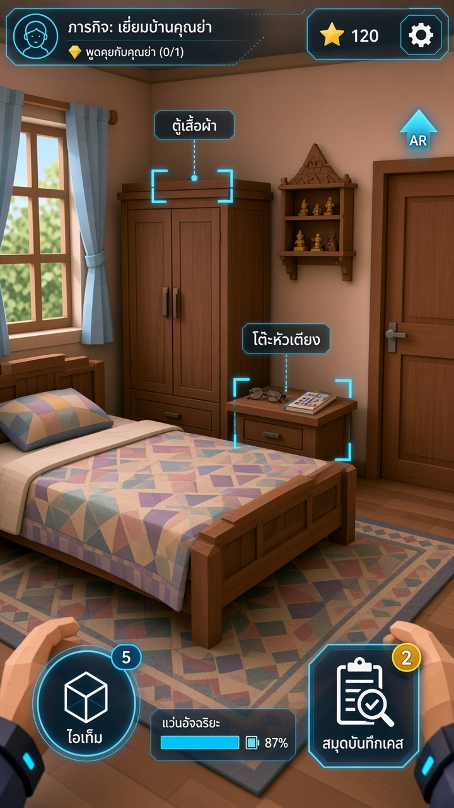 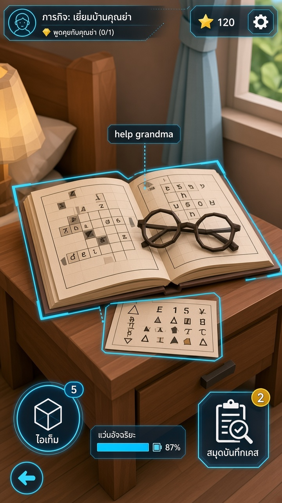 |
| ห้องทำงาน | 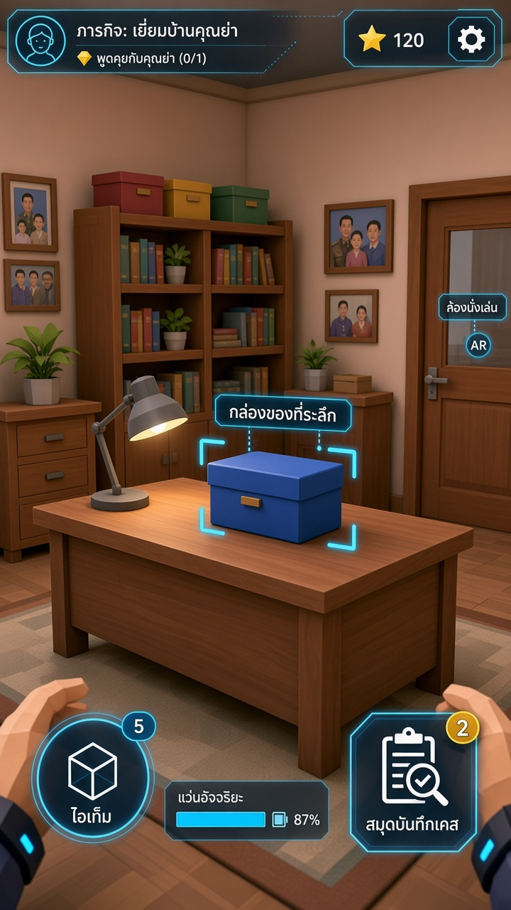 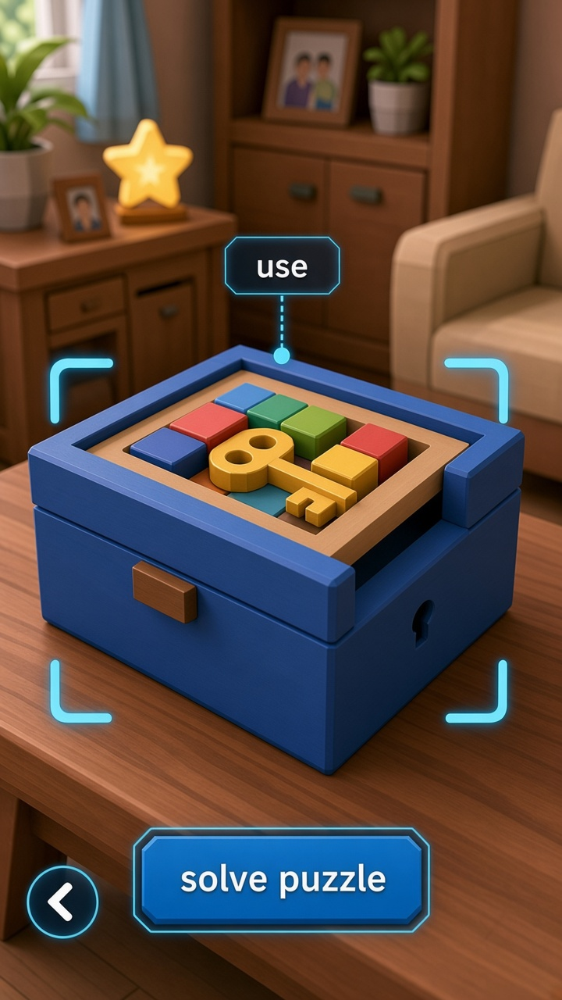 |

- ห้องนั่งเล่น: กว้าง, คุณยาย, โต๊ะ
- ห้องนอนคุณยาย: กว้าง, โต๊ะหัวเตียง
- ห้องทำงาน: กว้าง, กล่องสีน้ำเงิน

## 5. ลำดับเรื่อง (แทนที่ด้วยไฟล์คดี 01)

> หมายเหตุ: ผู้ใช้ให้ยึดไฟล์คดี 01 เป็นหลัก ลำดับเรื่องและตัวละครในหัวข้อนี้ถูกแทนที่ด้วยไฟล์คดี กำลังปรับให้เข้ากับมุมมองบุคคลที่หนึ่ง

1. คุยกับคุณยาย ได้กระดาษสัญลักษณ์
2. ห้องนอน: ครอสเวิร์ดเป็นงานเสริมช่วยคุณยาย + พบตารางถอดรหัส ได้คำว่า "กล่องสีน้ำเงิน"
3. กลับห้องนั่งเล่น แสดงคำให้คุณยาย เธอนึกถึงแผนผังที่ฉีกขาด ต่อจิ๊กซอว์แล้วรู้ว่ากล่องอยู่ห้องทำงาน
4. ห้องทำงาน: แก้ปริศนาเลื่อนบล็อกบนฝากล่อง พบอัลบั้มและโปสการ์ด

## 6. แผนผังบ้าน (ใช้ในจิ๊กซอว์)
- ลายเส้นหมึกบนกระดาษครีม มุมมอง top-down แบบ floor plan ฉีกเป็นชิ้น
- ของจริงจะวาดเป็นเวกเตอร์ให้ตรงกับฉาก 3 มิติ
- ภาพร่างวางกล่องดาวไว้ในครัว ซึ่งผิดตำแหน่ง ต้องอยู่ห้องทำงาน

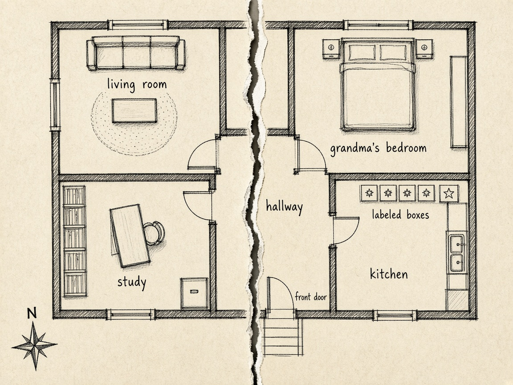

## 7. กล่องสีน้ำเงิน
- กุญแจเป็นชิ้นหนึ่งในถาดเลื่อนบล็อกบนฝา
- มีช่องทางออกด้านข้างไปยังรูกุญแจหน้ากล่อง

## หมายเหตุ
- ภาพทั้งหมดเป็นภาพร่างจาก AI ตัวหนังสือบางจุดเพี้ยน และรายละเอียดข้ามภาพยังไม่ตรงกัน

## บทสนทนาคุณยาย (ตัดสินใจแล้ว)

**บุคลิกยายมะลิ:**
- อบอุ่น ชอบเล่าเรื่องเก่า ๆ
- ไม่ขี้ลืมจนบดบังเบาะแส
- เป็นผู้เปิดคดีและให้กำลังใจผู้เล่น ไม่ใช่ผู้ต้องสงสัย
- คำใบ้เป็นแบบอ้อม ๆ ไม่บอกคำตอบตรง ๆ

**ตัวอย่างบทพูดที่อนุมัติแล้ว:**
- เปิดคดี: "หลานมาแล้วเหรอจ๊ะ ยายหาอัลบั้มรูปครอบครัวไม่เจอ ในนั้นมีรูปตาตอนหนุ่ม ๆ ด้วยนะ"
- ถูกถาม: "เมื่อเช้ายายยังเห็นวางอยู่บนโต๊ะกลางเลย แต่บ่ายนี้น้ารินเข้ามาเก็บกวาดนะ"
- ผู้เล่นติด: "รูปเก่า ๆ บ้านนี้เขาเก็บไว้ที่เดียวกันมาตลอดแหละ ลองต่อแผนที่ที่หล่นกระจายอยู่ดูสิ"
- ไขคดีได้: "นี่ไงรูปตา ขอบใจนะหลาน มานั่งดูด้วยกันมา ยายจะเล่าให้ฟัง"

> หมายเหตุ: บทพูด "ถูกถาม" และ "ผู้เล่นติด" ปรับแล้วให้ตรงกับเวลาในไฟล์คดี 01 (อัลบั้มอยู่บนโต๊ะเมื่อเช้า น้ารินย้ายช่วงบ่าย) และแผนผังจิ๊กซอว์แม่เหล็กที่หล่นกระจาย
>
> หมายเหตุ: บทพูดเหล่านี้ใช้เสริมบทสนทนาในไฟล์คดี 01 หากขัดกัน ให้ยึดไฟล์คดี 01 เป็นหลัก

## ขอบเขตห้องส่วนตัว (ตัดสินใจแล้ว)

- ห้องของผู้เล่นเป็นศูนย์กลาง (hub) ของเกม: เกมเปิดที่ห้องนี้ ผู้เล่นออกเดินทางไปเยี่ยมบ้านย่า และกลับมาที่ห้องเมื่อไขคดีสำเร็จ
- **ขอบเขตต้นแบบ:**
  - ตกแต่งด้วยช่องวางของตายตัว 6–8 ช่อง (ผนัง ชั้น โต๊ะ พื้น ฯลฯ) แตะช่องเพื่อวางหรือสลับของ
  - ของตกแต่งได้จากการไขคดีและงานเสริม (เช่น ครอสเวิร์ดของลุงเมฆ)
  - ชั้นเก็บของที่ระลึกจากคดี (เช่น โปสการ์ด รูปจากอัลบั้ม)
  - กระดานคดีที่ไขแล้ว
  - ประตูไปคดีถัดไป
- **เลื่อนไปภายหลัง:** ร้านค้า สกุลเงินในเกม การลากวางของอิสระ
- ใช้กติกาภาพและกล้องเดียวกัน: มุมกว้าง 1 มุม เฟดเข้ามุมใกล้ ปุ่มย้อนกลับมุมล่างซ้าย

## สูตรความชำนาญ (ตัดสินใจแล้ว — ปรับล่าสุด: 3 ดาวต้องทันเวลาเป้าหมาย)

- มินิเกมแต่ละแบบ (ครอสเวิร์ด จิ๊กซอว์ เลื่อนบล็อก) มีความชำนาญแยกกัน แสดงเป็นดาว 1–3 ดวงต่อการเล่นหนึ่งครั้ง
  - เล่นจบ = 1 ดาว
  - เล่นจบโดยใช้คำใบ้ไม่เกิน 1 ครั้ง (เวลาเท่าไรก็ได้) = 2 ดาว
  - เล่นจบโดยไม่ใช้คำใบ้ **และ** ภายในเวลาเป้าหมาย = 3 ดาว
- เวลาเป้าหมายขึ้นกับระดับความยากที่ผู้เล่นเลือกทุกครั้งที่เริ่มคดี (ตอนออกจากประตูห้อง) (ง่าย / ปกติ / ยาก)
- เกินเวลาเป้าหมายไม่ทำให้แพ้ ได้สูงสุด 2 ดาว
- ระหว่างเล่นแสดงเฉพาะเวลาที่ใช้และสถิติดีที่สุดของตัวเอง **ไม่แสดงเวลาเป้าหมาย** (ซ่อนไว้ ใช้ภายในเพื่อตัดสิน 3 ดาวเท่านั้น) ตัวแสดงดาวขณะเล่นแสดงได้ แต่ต้องไม่เผยเวลาเป้าหมาย
- เก็บผลที่ดีที่สุดไว้ ดาวรวมใช้ปลดล็อกของตกแต่งห้องส่วนตัว
- ไม่มีบทลงโทษ

**เวลาเป้าหมายเริ่มต้น (สำหรับ 3 ดาว) — สำหรับทีมออกแบบเท่านั้น ซ่อนจากผู้เล่น**

| มินิเกม | ง่าย | ปานกลาง | ยาก |
|---|---|---|---|
| ครอสเวิร์ด | 6 นาที | 4 นาที | 3 นาที |
| จิ๊กซอว์ | 4 นาที | 3 นาที | 2 นาที |
| เลื่อนบล็อก | 3 นาที | 2 นาที | 1.5 นาที |

> ค่าเริ่มต้นเท่านั้น ต้องปรับจากการทดลองเล่น

## การสรุปคดี (ตัดสินใจแล้ว)

- เมื่อเก็บหลักฐานครบพอ (E01, E02, E04) กระดานคดีเปิดปุ่ม **สรุปคดี** พร้อมคำถาม 3 ข้อ
- แต่ละข้อต้องเลือกคำตอบ **และ** เลือกการ์ดหลักฐาน 1 ใบมายืนยัน (ต้นแบบใช้แตะเลือกแทนการลาก)

| ข้อ | คำถาม | วิธีตอบ | คำตอบ | หลักฐานที่รับ |
|---|---|---|---|---|
| 1 | ใครย้ายอัลบั้ม? | เลือกรูป: ยายมะลิ / ลุงเมฆ / น้าริน | น้าริน | `E01` ข้อความของน้าริน (รับ `E03` คำบอกเล่าลุงเมฆ ได้ด้วย) |
| 2 | ย้ายทำไม? | เลือก: น้ำหกบนโต๊ะ / แอบซ่อนไว้ / หยิบไปดูรูป | น้ำหกบนโต๊ะ | `E02` โต๊ะที่เปียก (ผ้าเปียกในครัวยืนยัน `E02`) |
| 3 | เก็บไว้ที่ไหน? | แตะตำแหน่งบนแผนผังบ้าน | ห้องทำงาน ใต้หน้าต่าง | `E04` แผนผังบ้าน: ภาพถ่ายเก็บใต้หน้าต่างห้องทำงาน |

- ตอบผิด (คำตอบหรือหลักฐาน): ไม่มีบทลงโทษ ยายมะลิให้คำใบ้อ้อม ๆ (ร่างบทพูด รออนุมัติ):
  - ข้อ 1: "ลองอ่านกระดาษบนโต๊ะอีกทีสิจ๊ะ ใครเป็นคนเขียนไว้นะ"
  - ข้อ 2: "โต๊ะยังเปียกอยู่เลยนะ หลานว่าเกิดอะไรขึ้น"
  - ข้อ 3: "รูปเก่า ๆ บ้านนี้เขาเก็บไว้ที่เดียวกันมาตลอดแหละ ลองต่อแผนที่ที่หล่นกระจายอยู่ดูสิ" (บทที่อนุมัติแล้ว)
  - หลักฐานไม่ตรง: "คำตอบอาจถูกแล้ว แต่หลักฐานใบนี้ยังไม่ได้บอกเรื่องนั้นนะ"
- ถูกครบ 3 ข้อ → ปลดล็อกการเปิดกล่องในห้องทำงาน (เลื่อนบล็อก) → พบอัลบั้ม (`E05`)
- การเลือกระหว่างกล่องรูปดาว/กล่องรูปใบไม้ในห้องทำงาน ยังใช้ `E03` (สัญลักษณ์รูปดาว) ตามฉาก 4 ของไฟล์คดี

## ระบบคำใบ้ (ตัดสินใจแล้ว)

- คำใบ้มาจาก **ปุ่มคำใบ้บนหน้าจอ (รูปหลอดไฟ)** มี 3 ระดับ:
  1. บอกว่าควรไปดูที่ห้องไหน
  2. ไฮไลต์วัตถุที่ควรแตะ
  3. (เฉพาะมินิเกม) เผยขั้นที่ถูกต้อง 1 ขั้น (เช่น เติมตัวอักษร 1 ช่อง วางชิ้นจิ๊กซอว์ 1 ชิ้น เลื่อนบล็อกที่ถูก 1 ครั้ง)
- ยายมะลิให้คำใบ้ **เฉพาะหลังตอบผิดบนกระดานสรุปคดี** เท่านั้น (บทพูด "ผู้เล่นติด" ที่อนุมัติไว้ใช้เป็นคำใบ้ของยายเมื่อตอบข้อ 3 "เก็บไว้ที่ไหน" ผิด)
- เฉพาะคำใบ้ที่ใช้ **ในมินิเกม** เท่านั้นที่มีผลต่อดาวของมินิเกมนั้น คำใบ้สำรวจนอกมินิเกม (ระดับ 1–2) และคำใบ้ของยายบนกระดานสรุปคดี **ใช้ได้ฟรี ไม่มีผลต่อดาวใด ๆ** ไม่มีดาวระดับคดี (ยืนยันแล้ว)
- ปุ่มคำใบ้รูปหลอดไฟ อยู่ใกล้ HUD ด้านบน ไม่ใช่มุมล่างซ้าย (ที่ของปุ่มย้อนกลับ)

## แพลตฟอร์ม (ยืนยันแล้ว)

- เล่นบน **มือถือ แนวตั้ง สัมผัสหน้าจอ** ไม่ใช่ VR/AR
- "แว่น AR" เป็นเพียงแรงบันดาลใจด้านภาพของมุมมองบุคคลที่หนึ่งและ HUD เท่านั้น ไม่ใช่อุปกรณ์หรือตัวละครในเกม — ในเกมคือ **HUD บนหน้าจอ (สไตล์ได้แรงบันดาลใจจากแว่น AR)**

## การเริ่มเกม (ตัดสินใจแล้ว)

- (ค่าตั้งต้น ผู้ใช้ปรับได้) เกมเปิดที่ห้องของผู้เล่น
- บทสอนสั้น 3 ขั้นผ่าน HUD: (1) แตะวัตถุ (2) ปุ่มย้อนกลับ (3) เปิดสมุด/กระดานคดี
- เลือกระดับความยาก (ง่าย / ปานกลาง / ยาก) ทุกครั้งที่เริ่มคดี ตอนออกจากประตูห้อง ระดับที่เลือกกำหนดเวลาเป้าหมายสำหรับ 3 ดาว ตัวเลือกแสดงเฉพาะชื่อระดับ ไม่แสดงเวลา

## กลุ่มผู้เล่น (ตัดสินใจแล้ว)

- **ทุกวัย** เน้นครอบครัวเล่นด้วยกันบนมือถือเครื่องเดียว (ส่งต่อกันเล่น) ต้นแบบยังเป็นเกมเล่นเดี่ยว ใช้เครื่องร่วมกัน
- **ผลต่อการออกแบบ:**
  - ภาษาไทยง่าย ประโยคสั้น
  - มีปุ่มเปิด/ปิด **เสียงพากย์** อ่านบทสนทนาและเบาะแส สำหรับเด็กเล็กที่ยังอ่านไม่คล่อง (ไม่บังคับ)
  - ปรับขนาดตัวอักษรได้
  - ระดับความยาก (ง่าย / ปานกลาง / ยาก) รองรับสมาชิกครอบครัวต่างวัย

## เสียง (ตัดสินใจแล้ว)

- ดนตรีพื้นหลัง: นุ่ม อบอุ่น บรรยากาศบ้านชนบท
- เสียงประกอบสั้น ๆ: แตะวัตถุ พบหลักฐาน ได้ดาว
- เสียงพากย์บทสนทนา (และเบาะแส): ต้นแบบแรกใช้ **Thai TTS** เปิด/ปิดได้ อาจใช้นักพากย์จริงภายหลัง

## ยังไม่ล็อก
- (ไม่มี)
