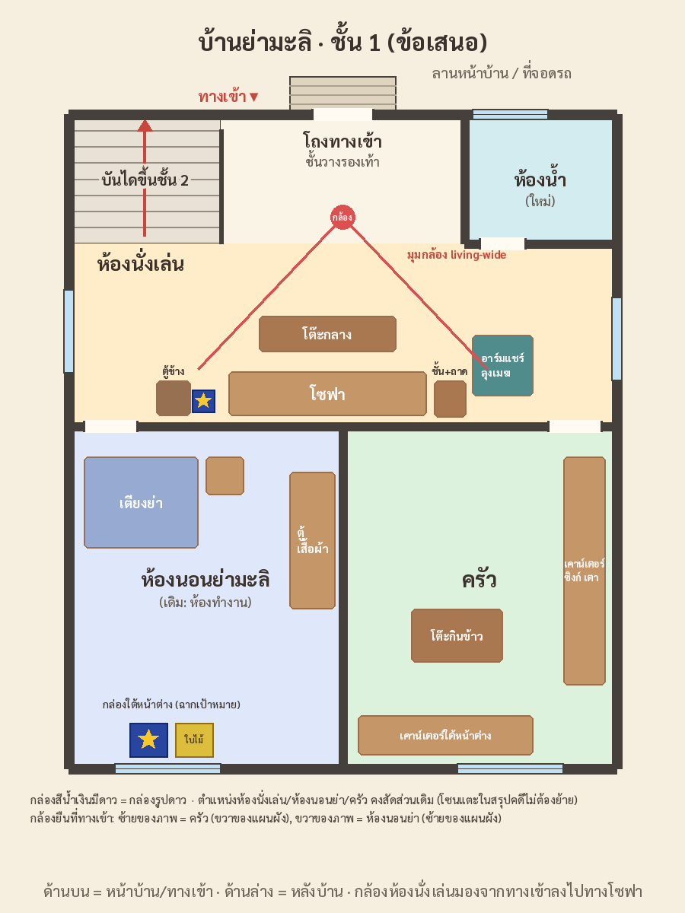
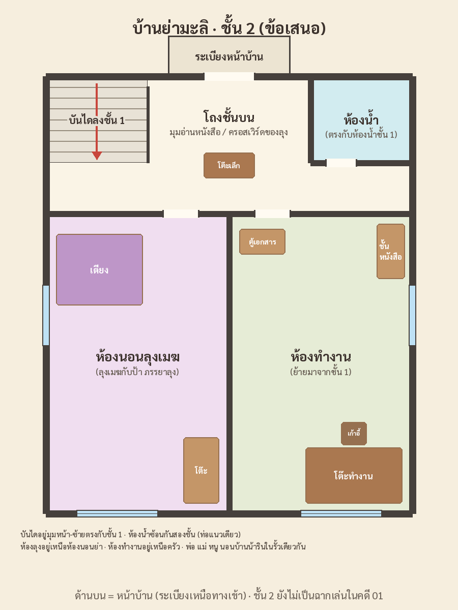

# ข้อเสนอ: บ้านย่ามะลิ v2 (บ้านสองชั้น)

| ฟิลด์ | ค่า |
|---|---|
| สถานะ | เฟส 1 ทำแล้วบนเครื่อง (commit `0837d5c` บน `cursor/cutscene-caption-band` ยังไม่ push ยังไม่ release) · เฟส 2 ยังไม่เริ่ม |
| วันที่ | 22 พ.ย. 2026 |
| อ้างอิง | `public/img/house-map.jpg`, `public/img/living-wide.jpg`, `public/img/cutscene-01-p2.jpg`, `public/data/case-flow.json`, `scripts/author-flow.mjs`, `src/modules/cutscene/registry.ts`, `src/modules/character/registry.ts`, `src/modules/event-core/FlowView.svelte`, `docs/design/never-ending-story-game-case-01-missing-family-album-th.md` |
| ภาพประกอบ | `docs/design/concepts/house-v2/floor1.png`, `docs/design/concepts/house-v2/floor2.png` |

## 1. สิ่งที่ผู้ใช้แจ้ง

1. โซฟาบนแผนผังบ้านอยู่ผิดที่ ทางเข้าบ้านควรอยู่ด้านบน กล้องห้องนั่งเล่นมองจากหน้าบ้านไปทางครัวและห้องทำงาน โซฟาจึงต้องอยู่ด้านล่างของห้องนั่งเล่น
2. การ์ตูนเปิดเรื่องวาดบ้านย่าเป็นเรือนไทยใต้ถุนสูง แต่ห้องที่เล่นเป็นบ้านสมัยใหม่ ต้องเปลี่ยนภาพเปิดเรื่องเป็นบ้านสองชั้น
3. บ้านตอนนี้มีชั้นเดียว ไม่มีห้องน้ำและห้องนอน ห้องทำงานควรเป็นห้องนอนย่า ลุงเมฆนอนชั้น 2 ส่วนน้าและอานอนบ้านอื่น

## 2. สภาพปัจจุบัน (ตรวจจากไฟล์จริง)

### 2.1 แผนผังบ้าน (`house-map.jpg`, 768×1024 สัดส่วน 3:4)
- ห้องนั่งเล่นอยู่ครึ่งบน ห้องทำงานอยู่ล่างซ้าย ครัวอยู่ล่างขวา
- **โซฟาชิดผนังด้านบนสุดของห้องนั่งเล่น** (ราว y 12–22% ของภาพ) หันหน้าลงไปทางโต๊ะกลาง
- บันไดหน้าบ้านอยู่ **ขอบล่าง** ของภาพ เข้าทางห้องล่างซ้าย ซึ่งก็คือห้องทำงาน แปลว่าเข้าบ้านแล้วต้องเดินผ่านห้องทำงานก่อน
- ภาพนี้ถูกใช้ 4 ที่: ฉาก `house-map`, จิ๊กซอว์ในถาด (E04), จิ๊กซอว์โหมด challenge, และหน้า 2 ของโปรล็อก (คำบรรยาย "บ้านไม้หลังเก่าของคุณย่ามะลิ")

### 2.2 มุมกล้องห้องนั่งเล่น (`living-wide.jpg`)
- กล้องยืนฝั่งหน้าบ้าน มองไปที่ผนังด้านใน โซฟาชิดผนังด้านในนั้น
- ประตูครัวอยู่ **ซ้ายของภาพ** (จุดแตะ x 12%) ประตูห้องทำงานอยู่ **ขวาของภาพ** (x 92%)
- อาร์มแชร์ลุงเมฆอยู่ซ้าย ชั้นกับถาดชิ้นแผนผังอยู่หลังโซฟาค่อนซ้าย กล่องรูปดาว (หลอก) กับพัดลมอยู่ขวาของโซฟา โต๊ะกลางอยู่หน้าโซฟาใกล้กล้อง

### 2.3 ทำไมขัดกัน
โซฟาในภาพห้องชิดผนังเดียวกับประตูครัวและประตูห้องทำงาน แต่ในแผนผัง ประตูสองบานนั้นอยู่ผนังล่างของห้องนั่งเล่น ส่วนโซฟาไปชิดผนังบน ถ้าวางกล้องตามแผนผังเดิม กล้องจะต้องยืนที่ผนังล่างแล้วหันขึ้น ซึ่งจะเห็นประตูครัวอยู่ขวาและห้องทำงานอยู่ซ้าย กลับด้านกับภาพจริง และทางเข้าบ้านก็ไปอยู่ด้านล่างผ่านห้องทำงาน

เมื่อย้ายทางเข้าไปผนังบนและให้โซฟาชิดผนังล่าง กล้องที่ยืนตรงทางเข้าแล้วหันลง (ไปทางหลังบ้าน) จะเห็นครัวอยู่ซ้ายของภาพ (ขวาของแผนผัง) และห้องทำงานอยู่ขวาของภาพ (ซ้ายของแผนผัง) **ตรงกับ `living-wide.jpg` ทุกจุดโดยไม่ต้องวาดห้องนั่งเล่นใหม่**

### 2.4 ภาพเปิดเรื่อง
- `cutscene-01-p2.jpg` ทั้ง 3 ช่องเป็นเรือนไม้ใต้ถุนสูง (ภายนอก, ย่ายืนที่ประตูไม้, แม่กอดหนูบนชานไม้) และเป็นแสงเย็น ทั้งที่คำบรรยายบอก "เช้าวันเสาร์"
- ภาพนี้เป็นปกการ์ดเหตุการณ์ด้วย (`cover` ใน `author-flow.mjs`)
- ข้อความที่พูดถึงบ้านไม้: `prologue.p2.caption` (th/en), หน้า p2 ของ case-01 ("ถึงบ้านไม้", "ครอบครัวมาถึงบ้านไม้ของคุณย่า") ทั้งใน `author-flow.mjs`, `case-flow.json`, `story-packs/case-01/case.json`, พรอมต์ใน `cutscene/registry.ts` (`STYLE` มีคำว่า "Thai wooden house", `case-01.p2` มีคำว่า "stilt wooden house", `prologue.house-map` มีคำว่า "wooden house") และสเปก v0.4 บรรทัด 60
- ภาพในบ้านทุกใบ (ห้องนั่งเล่น 3 ช่วงเวลา, ครัว, ห้องทำงาน, ฉากจบ) เป็นบ้านสมัยใหม่พื้นไม้ ใช้ต่อได้

## 3. ผังครอบครัว (ตรวจคำเรียกญาติ)

| ตัวละคร | ข้อมูลปัจจุบัน | ตามคำเรียกไทย | สถานะ |
|---|---|---|---|
| ย่ามะลิ | "คุณย่า เจ้าของบ้าน" | ย่า = แม่ของพ่อ | ถูก ดังนั้นบ้านนี้เป็นบ้านฝั่งพ่อ |
| พ่อ | ไม่ปรากฏในเกม | ลูกของย่า | ยังไม่มีตัว (แนะนำให้ปรากฏในภาพเปิดเรื่องใหม่ เช่นขับรถมา) |
| แม่ | โทรคุยกับย่า เรียกย่าว่า "คุณแม่" | สะใภ้ของย่า เรียก "คุณแม่" ได้ | ถูก |
| ลุงเมฆ | "ลุง ชวนเล่นครอสเวิร์ด" | ลุง = พี่ชายของพ่อหรือแม่ ในบ้านนี้คือพี่ชายของพ่อ ลูกของย่า | ถูก และอยู่บ้านย่าได้ |
| **น้าริน** | "น้าที่ย้ายอัลบั้มออกจากโต๊ะที่เปียก" มาช่วยเก็บกวาดบ้านย่า เขียนโน้ตว่า "ย่าคะ ... หนูเลยย้าย ... — ริน" | น้า = น้องของ **แม่** | **ไม่ใช่ลูกของย่า** ดูหัวข้อ 3.1 |
| ป้า | ยังไม่มีในเกม | ภรรยาของลุงเมฆ (เรียกป้าตามสามี) | ตัดสินแล้ว 22 พ.ย. 2026 อยู่บ้านย่า นอนชั้น 2 กับลุง |
| อา | ยังไม่มี | น้องของ **พ่อ** ลูกของย่า | ใหม่ |

### 3.1 ปัญหาน้าริน
- ถ้าย่ามะลิเป็นย่า ลูก ๆ ของย่าคือ พ่อ, ลุง/ป้า (พี่ของพ่อ) และอา (น้องของพ่อ) **ไม่มีน้าในสายนี้** น้ารินจึงเป็นน้องสาวของแม่ อยู่คนละครอบครัวกับย่า
- ที่มาของความไม่ตรง: เอกสารรุ่นแรก `design-decisions-2026-10-22-th.md` ใช้ "คุณยาย" (แม่ของแม่) ซึ่งตอนนั้นน้ารินเป็นลูกของยายพอดี ต่อมาเปลี่ยนเป็น "ย่า" แต่ไม่ได้เปลี่ยนน้าริน
- โน้ตที่ขึ้นต้น "ย่าคะ" ยังพอรับได้ถ้าถือว่าผู้ใหญ่เรียกตามหลาน (ธรรมเนียมไทย) แต่การที่น้องสาวของสะใภ้มาเก็บกวาดบ้านแม่สามีของพี่สาว และรู้ "ผังเก็บของเดิมของบ้าน" ดี ทำให้เรื่องดูแปลก
- **เอกสารนี้ยังไม่เปลี่ยนชื่อใคร** ทางเลือก:

| ทางเลือก | ความหมาย | สิ่งที่ต้องแก้ | ข้อดี / ข้อเสีย |
|---|---|---|---|
| A. คงชื่อ "น้าริน" | น้องสาวแม่ บ้านอยู่ใกล้ แวะมาช่วยย่าเป็นประจำ | บทบาทใน `character.auntRin.role` และเอกสารคดี บอกให้ชัดว่าเป็นน้องแม่ โน้ตอาจคง "ย่าคะ" (เรียกตามหลาน) | ไม่ต้องแก้ชื่อหรือภาพ / เหตุผลที่น้ารู้ผังเก็บของบ้านย่าอ่อน |
| B. เปลี่ยนเป็น "อาริน" | น้องสาวพ่อ ลูกของย่า แต่งงานแล้วอยู่บ้านอื่น | ชื่อในทุกบท โน้ต E01 ตัวเลือกคำตอบ "ใครย้ายอัลบั้ม" locales (คงรหัส `rin`/`auntRin`) โน้ตเปลี่ยนเป็น "แม่คะ ... — ริน" | ตรงที่สุด เป็นลูกย่าจึงรู้ผังเก็บของ / แก้ข้อความหลายจุด ผู้เล่นเดิมเคยเห็นชื่อน้าริน |
| C. ให้รินเป็น "ป้าริน" ภรรยาลุงเมฆ | สะใภ้ อยู่บ้านย่าชั้น 2 | ชื่อทุกจุด และเรื่อง "บ่ายนี้รินมาช่วยเก็บกวาด" ต้องเปลี่ยนเพราะอยู่บ้านนี้อยู่แล้ว | ขัดกับที่ผู้ใช้บอกว่าน้านอนบ้านอื่น ไม่แนะนำ |

**ตัดสินแล้ว (22 พ.ย. 2026): ทางเลือก A** น้ารินเป็นน้องสาวของแม่ บ้านของน้าอยู่อีกหลังในรั้วเดียวกับบ้านย่า (จึงแวะมาช่วยย่าเก็บกวาดได้ง่ายและรู้ผังเก็บของ) ไม่เปลี่ยนชื่อ แก้บทบาทใน `character.auntRin.role` (th/en) ให้บอกว่าเป็นน้องสาวของแม่และอยู่ในรั้วเดียวกันแล้ว โน้ต "ย่าคะ" คงไว้ (เรียกตามหลาน)

### 3.2 ใครนอนที่ไหน
| คน | ที่นอน |
|---|---|
| ย่ามะลิ | ชั้น 1 ห้องนอนย่า (เดิมห้องทำงาน) ผู้สูงอายุไม่ต้องขึ้นบันได |
| ลุงเมฆ | ชั้น 2 ห้องนอนลุง (อยู่กับย่า) |
| ป้า (ภรรยาลุงเมฆ) | ชั้น 2 ห้องเดียวกับลุงเมฆ |
| พ่อ แม่ หนู | แค่มาเยี่ยมบ้านย่า ค้างคืนที่บ้านน้าริน อีกหลังในรั้วเดียวกัน (ตัดสินแล้ว 22 พ.ย. 2026) |
| น้าริน | บ้านของตัวเอง อีกหลังในรั้วเดียวกับบ้านย่า มาช่วยเก็บกวาดบ่ายวันนั้น |
| อา | บ้านของตัวเอง ยังไม่ปรากฏในคดี 01 (เก็บไว้เป็นตัวละครคดีถัดไป) |

ป้าและอาไม่จำเป็นต้องมีในคดี 01 เพิ่มในทะเบียนตัวละครเมื่อมีบทจริง บ้านน้ารินในรั้วเดียวกันยังไม่อยู่ในภาพเปิดเรื่อง (ไม่บังคับ) ใส่ได้ตอนมีคดีที่ใช้

## 4. ผังบ้านใหม่

หลักการ: ด้านบนของแผนผัง = หน้าบ้าน/ทางเข้า ด้านล่าง = หลังบ้าน คงกรอบตัวบ้านและสัดส่วนห้องนั่งเล่น / ห้องซ้ายล่าง / ครัว ให้ใกล้ของเดิม เพื่อให้จุดแตะในฉากแผนผัง (living 50.2,27.5 · study 34.9,62.3 · kitchen 72.5,62.3) และโซนแตะคำถาม "เก็บไว้ที่ไหน" ใน `FlowView.svelte` (living บน 10–45%, ซ้ายล่าง 12–52%, ขวาล่าง 53–88%) ใช้ต่อได้

### 4.1 ชั้น 1



```
              ลานหน้าบ้าน / ที่จอดรถ
                    [บันไดหน้าบ้าน]
 +-----------+-------▼ประตู-------+-----------+
 | บันได     |  โถงทางเข้า        | ห้องน้ำ    |
 | ขึ้นชั้น 2 |  (กล้องยืนตรงนี้)   |  (ใหม่)   |
 +-----------+          ▼          +---ประตู---+
 |                 ห้องนั่งเล่น                 |
 |             [ โต๊ะกลาง ]          [อาร์มแชร์] |
 | [ตู้ข้าง][★]  [====== โซฟา ======] [ชั้น+ถาด]|
 +ประตู-------------------+--------------ประตู+
 |  ห้องนอนย่ามะลิ         |  ครัว               |
 |  (เดิม: ห้องทำงาน)      |                    |
 |  [เตียง]      [ตู้]     |      [โต๊ะกินข้าว]  |
 |  [★][ใบไม้] ใต้หน้าต่าง  |  [เคาน์เตอร์]       |
 +==หน้าต่าง==============+=====หน้าต่าง=======+
                     หลังบ้าน
```

| ห้อง | สถานะ | หมายเหตุ |
|---|---|---|
| โถงทางเข้า | ใหม่ (ไม่ใช่ฉาก) | ทางเข้าอยู่ผนังบน กล้องห้องนั่งเล่นยืนตรงนี้ |
| ห้องนั่งเล่น | คงเดิม | โซฟาย้ายไปชิดผนังล่าง ภาพห้องไม่ต้องวาดใหม่ |
| ห้องนอนย่ามะลิ | เปลี่ยนจากห้องทำงาน | กล่องรูปดาวกับกล่องใบไม้คงอยู่ใต้หน้าต่างผนังล่าง ตำแหน่งเดิม |
| ครัว | คงเดิม | |
| ห้องน้ำ | ใหม่ | มุมหน้าขวา อยู่หลังกล้อง ไม่โผล่ใน `living-wide.jpg` |
| บันได | ใหม่ | มุมหน้าซ้าย อยู่หลังกล้อง ไม่โผล่ใน `living-wide.jpg` |

### 4.2 ชั้น 2



```
                [ระเบียงหน้าบ้าน]
 +-----------+-------ประตู--------+-----------+
 | บันได     |  โถงชั้นบน          | ห้องน้ำ    |
 | ลงชั้น 1   |  มุมอ่านหนังสือ     | (ซ้อนชั้น1)|
 +-----------+  [โต๊ะเล็ก]          +---ประตู---+
 |                                             |
 +-------ประตู-------------+--ประตู-------------+
 |  ห้องนอนลุงเมฆ           |  ห้องทำงาน          |
 |  (ลุงเมฆกับป้า ภรรยาลุง)  |  (ย้ายมาจากชั้น 1)   |
 |  [เตียง]   [โต๊ะ]        | [ตู้เอกสาร] [ชั้นหนังสือ]|
 |                         |      [โต๊ะทำงาน]    |
 +==หน้าต่าง===============+=====หน้าต่าง=======+
```

| ห้อง | สถานะ | หมายเหตุ |
|---|---|---|
| โถงชั้นบน | ใหม่ | มุมครอสเวิร์ดของลุง เปิดออกระเบียงหน้าบ้าน |
| ห้องนอนลุงเมฆ | ใหม่ | อยู่เหนือห้องนอนย่า |
| ห้องทำงาน | ใหม่ (ย้ายจากชั้น 1) | อยู่เหนือครัว โต๊ะทำงานใต้หน้าต่างหลังบ้าน ชั้นหนังสือ ตู้เอกสาร (ผู้ใช้ตัดสิน 22 พ.ย. 2026: เปลี่ยนจากห้องนอนแขก) |
| ห้องน้ำชั้น 2 | ใหม่ | ซ้อนกับห้องน้ำชั้น 1 |
| ระเบียง | ใหม่ | เหนือทางเข้า เห็นได้จากภาพภายนอก |

ชั้น 2 ยังไม่เป็นฉากเล่นในคดี 01 บนแผนผังแสดงเป็นสีเทาพร้อมป้าย "ยังไม่เปิด" จนกว่าจะมีคดีที่ใช้

## 5. ฉากและภาพ: คง / เปลี่ยน / ใหม่

| ไฟล์ / ฉาก | ผล | เฟส |
|---|---|---|
| `living-wide.jpg`, `living-wide-afternoon.jpg`, `living-wide-yesterday.jpg`, `living-table.jpg`, `living-shelf-tray.jpg`, `living-grandma.jpg`, `uncle-mek.jpg`, `rin.jpg` | คง (ตรงกับผังใหม่แล้ว) | – |
| `kitchen-wide.jpg`, `kitchen-close.jpg` | คง | – |
| `ending-01…05.jpg`, `album-found.jpg`, `player-room-wide.jpg` | คง | – |
| `cutscene-01-p1.jpg` | คง (บ้านของหนู ไม่ใช่บ้านย่า) | – |
| `house-map.jpg` | วาดใหม่: ทางเข้าบน โซฟาชิดผนังล่าง บันไดกับห้องน้ำหน้าบ้าน | 1 (ห้องซ้ายล่างยังเป็นโต๊ะทำงาน) แล้ว 2 (เปลี่ยนเป็นเตียง) |
| `cutscene-01-p2.jpg` | วาดใหม่ทั้ง 3 ช่อง เป็นบ้านสองชั้นสมัยใหม่ แสงเช้า | 1 |
| `study-wide.jpg`, `study-box.jpg` | วาดใหม่เป็นห้องนอนย่า คงหน้าต่างและกล่องสองใบไว้ตำแหน่งเดิมในภาพ เพื่อให้จุดแตะ (66.5,64 / 50.8,63 และ 46.5,70 / 52.6,44.8) ไม่ต้องย้าย | 2 |
| `house-map-2f.jpg` | ใหม่: แผนผังชั้น 2 | 2 |
| ฉากบันได / โถงชั้นบน / ห้องลุง / ห้องทำงานชั้น 2 / ห้องน้ำ | ยังไม่ทำ เป็นฉากของคดีถัดไป | หลังเฟส 2 |

## 6. ทิศทางภาพเปิดเรื่องใหม่ (`cutscene-01-p2.jpg`)

- สไตล์เดิม: low-poly 3 มิติแบบสมุดนิทาน ผิวเหลี่ยมเหมือนดินปั้น แสงอุ่น ภาพแนวตั้ง 3 ช่อง ไม่มีตัวหนังสือ
- **ช่อง 1 (ภายนอก):** บ้านเดี่ยวสองชั้นสมัยใหม่แบบไทยชานเมือง ผนังปูนสีครีม หลังคาจั่วกระเบื้องสีน้ำตาลอมเทา ชายคายื่นกันแดดฝน ชั้น 2 มีระเบียงราวเหล็กเหนือประตูหน้า ประตูไม้บานใหญ่ตรงกลางชั้น 1 หน้าต่างบานเลื่อนกรอบไม้สีเดียวกับในห้อง บันไดหน้าบ้าน 3 ขั้น ลานหน้าบ้านปูกระเบื้องมีรถเก๋งเล็ก (พ่อเพิ่งลงจากรถ ถ้าตัดสินใจให้พ่อปรากฏ) ต้นมะม่วง กระถางต้นไม้ แสงเช้าสีทองอ่อน ท้องฟ้าใส
- **ช่อง 2:** ย่ามะลิ (ผมสีเงินสั้นปล่อยหลวม ห้ามมวย เสื้อคาร์ดิแกนม่วงอ่อน ผ้าซิ่นม่วง) ยืนที่ประตูหน้าที่เปิดอยู่ กางแขนต้อนรับ เห็นโถงทางเข้าและชั้นวางรองเท้าด้านใน ผนังครีม พื้นไม้ลายเดียวกับห้องนั่งเล่น
- **ช่อง 3:** แม่กอดหนูที่หน้าประตู มีรองเท้าวางหน้าบ้าน ฉากหลังเห็นบันไดในบ้านเล็กน้อย
- ห้ามมี: เรือนไทย ใต้ถุนสูง ชานไม้ ไม้ฝาเฟี้ยม หลังคาทรงไทยปั้นลม ตึกกระจกสูง
- ต้องสอดคล้อง: ประตูหน้าอยู่กลางผนังด้านหน้า (ตรงกับแผนผัง) ระเบียงชั้น 2 อยู่เหนือประตู หน้าต่างห้องน้ำเล็กด้านหน้าขวา
- แก้พรอมต์ใน `cutscene/registry.ts`: `STYLE` เปลี่ยน "Thai wooden house" เป็น "modern Thai two-storey family home", `case-01.p2` และ `prologue.house-map` ตัดคำว่า wooden/stilt ส่วน `character` ที่ผู้เล่น "standing in a wooden living room" เปลี่ยนเป็น "living room with wooden floor"
- ข้อความ: หน้า p2 "ถึงบ้านไม้" → "ถึงบ้านย่า", "เช้าวันเสาร์ ครอบครัวมาถึงบ้านไม้ของคุณย่า" → "เช้าวันเสาร์ ครอบครัวมาถึงบ้านของคุณย่า" และ `prologue.p2.caption` → "ไม่ไกลกันนัก มีบ้านสองชั้นของคุณย่ามะลิ เต็มไปด้วยของเก่าและความทรงจำ" (en ตามกัน)
- ธีมปฏิทิน "บ้านไม้" ใน `player-room.json` เป็นชื่อธีมของตกแต่ง ไม่ได้บอกว่าบ้านย่าเป็นเรือนไม้ คงไว้ได้

## 7. ผลกับจิ๊กซอว์ถาดชิ้นแผนผังและการปลดล็อกแผนผังบ้าน

- จิ๊กซอว์ตัดภาพ `house-map.jpg` ด้วย CSS เป็น 3×4 (คดี) และ 3×3 / 3×4 / 4×4 (challenge) **ภาพใหม่ต้องเป็น 3:4 เท่าเดิม** แล้วชิ้นจะเปลี่ยนตามเอง ไม่ต้องแก้ `puzzle.ts` หรือ `ruleset.json`
- ในคดี ชิ้นที่วางไว้แล้วคือ 0,1,2,3,5,6,9 ชิ้นที่ผู้เล่นต้องวางคือ 4,7,8,10,11 ในภาพใหม่ชิ้น 4 = กลางห้องนั่งเล่น (โซฟา/โต๊ะกลาง) ชิ้น 7/10 = ผนังกลางระหว่างห้องนอนย่ากับครัว ชิ้น 8/11 = ครัว ทุกชิ้นต้องมีรายละเอียดพอให้แยกได้ ห้ามเป็นพื้นว่าง
- เบาะแสกล่องรูปดาวใต้หน้าต่างอยู่ในชิ้น 9 (วางไว้แล้ว) เหมือนเดิม
- การปลดล็อก: เกต `E04` (`unlocksHouseMap`, `event-01/houseMap.ts`) ไม่เปลี่ยน ปุ่ม «แผนผังบ้าน» ยังซ่อนจนชนะจิ๊กซอว์
- จิ๊กซอว์เป็นแผนผังชั้น 1 เท่านั้น ชั้น 2 ไม่เข้าจิ๊กซอว์ (ถาดใน `living-shelf-tray.jpg` เป็นลายทั่วไป ใช้ต่อได้)
- เฟส 2: หลักฐาน E04 "แผนผังบ้าน: ภาพถ่ายเก็บใต้หน้าต่างห้องทำงาน" → "...ห้องนอนย่า" และฉากแผนผังมีปุ่มสลับ "ชั้น 1 / ชั้น 2"
- คะแนน challenge จิ๊กซอว์ที่ทำไว้กับภาพเก่ายังนับได้ (กริดเดิม) แต่ความยากอาจต่างเล็กน้อย
- แคช: Service worker ล้างแคชทุก deploy การเขียนทับชื่อไฟล์เดิมจึงพอ (สอดคล้องกฎ "ไฟล์ไม่ถูกย้าย" ใน GDD cutscene)

## 8. แผนเป็นเฟส

### เฟส 1: แก้โซฟา แผนผัง และภาพเปิดเรื่อง (ทำแล้วบนเครื่อง 22 พ.ย. 2026)
| งาน | ไฟล์ | โมดูล (bump) |
|---|---|---|
| ✅ วาด `house-map.jpg` ใหม่ ทางเข้าบน โซฟาชิดผนังล่าง บันไดกับห้องน้ำแถวหน้า (ยังไม่เข้า) ห้องซ้ายล่างวาดเป็นห้องนอนย่าแล้ว (เตียง ตู้ กล่องสองใบใต้หน้าต่าง) | `public/img/house-map.jpg`, `cutscene/registry.ts` (พรอมต์) | `cutscene` 1.0.0 → 1.0.1 |
| ✅ วาด `cutscene-01-p2.jpg` ใหม่ 3 ช่อง (ปกการ์ดเหตุการณ์ใช้ไฟล์เดียวกัน) | `public/img/cutscene-01-p2.jpg`, `cutscene/registry.ts` | `cutscene` (รอบเดียวกัน) |
| ✅ ข้อความหน้า p2 "บ้านไม้" → "บ้านย่า" และจุดห้องนั่งเล่นบนแผนผังย้ายเป็น y 41 | `scripts/author-flow.mjs`, `public/data/case-flow.json`, `story-packs/case-01/case.json` (แก้ตรง ๆ เพราะ `author-flow.mjs` ตามไฟล์ข้อมูลไม่ทันแล้ว ห้ามรันทับ) | `event-01` 1.0.9 (bump ไว้แล้วใน 0.6.34 ที่ยังไม่ release) |
| ✅ โซนแตะคำถาม "เก็บไว้ที่ไหน" ตามแผนผังใหม่ (นั่งเล่น 12–56%, ซ้ายล่าง/ครัว 57–88%) | `event-core/FlowView.svelte` | `event-core` 1.2.8 (ยังไม่ release) |
| ✅ คำบรรยายโปรล็อกหน้า 2 "บ้านสองชั้นของคุณย่ามะลิ" และบทบาทน้าริน | `src/locales/th.json`, `en.json` | `core` 0.6.34 |
| พรอมต์ผู้เล่นในห้อง (ไม่บังคับ) | `character/registry.ts` | `character` patch ถ้าแก้ |
| เอกสาร | สเปก v0.4 บรรทัด 60, `asset-list-th.md`, GDD cutscene/event-01 | – |

ไม่ต้องแตะ: `jigsaw` (ภาพยัง 3:4)
หมายเหตุ: บนแผนผังห้องซ้ายล่างเป็นเตียงแล้ว แต่ชื่อห้องในเกมและภาพ `study-wide.jpg` ยังเป็น "ห้องทำงาน" จนถึงเฟส 2
ตรวจ: ภาพแผนผังในฉาก house-map, จิ๊กซอว์คดีและ challenge, โปรล็อกหน้า 2, การ์ดเหตุการณ์ (ใช้ p2 เป็นปก), ขอบ overlay บนพื้นชมพูเข้ม #8B1E4F

### เฟส 2: เปลี่ยนผังบ้าน
| งาน | ไฟล์ | โมดูล (bump) |
|---|---|---|
| ภาพใหม่ `house-map-2f.jpg` (ห้องซ้ายล่างชั้น 1 วาดเป็นเตียงย่าแล้วในเฟส 1) | `public/img/`, `cutscene/registry.ts` (เพิ่ม `prologue.house-map-2f`) | `cutscene` minor |
| `study-wide.jpg`, `study-box.jpg` เป็นห้องนอนย่า | `public/img/`, `cutscene/registry.ts` | `cutscene` |
| ชื่อห้อง "ห้องทำงาน" → "ห้องนอนย่า" (ฉาก, ประตู, จุดแตะแผนผัง, บทย่าหลังสรุปคดี, map-clue, E04, คำตอบ "เก็บไว้ที่ไหน", goal) **คงรหัส `study` ไว้** ไม่ต้องย้ายเซฟ | `author-flow.mjs`, `case-flow.json`, `case.json`, `screens.json`, `th.json`/`en.json` (`dialogue.grandmaHasKey`) | `event-01` minor, `core` |
| ชื่อห้อง (ทางเลือกเรื่องรหัส) | ดูหมายเหตุใต้ตาราง | – |
| ฉากแผนผังมีปุ่มสลับชั้น 1/2 ชั้น 2 เป็นสีเทา "ยังไม่เปิด" และ aria-label ปุ่มคำตอบ "ห้องทำงาน" | `event-core/FlowView.svelte`, `session.svelte.ts`, `types.ts` | `event-core` minor |
| เพิ่มป้า (ภรรยาลุงเมฆ) และอา เมื่อมีบท | `character/registry.ts`, locales, เอกสารคดี | `character` (ถ้าเปลี่ยน), `event-01` |
| เทสต์ | `tests/mapUnlock.test.ts`, `tests/caseState.test.ts`, `cutsceneLayout.e2e.mjs` | – |

**หมายเหตุเรื่องรหัส `study`:** ห้องทำงานเดิมชั้น 1 กลายเป็นห้องนอนย่า และห้องทำงานย้ายขึ้นชั้น 2 ในเฟส 2 มีสองทาง
- ทาง 1 (ในตารางข้างบน): รหัส `study` ยังชี้ห้องนอนย่าชั้น 1 เปลี่ยนแค่ชื่อที่แสดง ห้องทำงานชั้น 2 ได้รหัสใหม่ (เช่น `study-2f`) ไม่ต้องย้ายเซฟ แต่ชื่อรหัสไม่ตรงความหมาย
- ทาง 2: ให้รหัส `study` ชี้ห้องทำงานชั้น 2 และห้องนอนย่าใช้รหัสใหม่ (เช่น `grandma-bedroom`) ชื่อตรงความหมาย แต่ฉาก `study`/`star-box` จุดแตะ คำตอบ `value: 'study'` ประตูในห้องนั่งเล่น goal และ `history = ['study', ...]` ใน `session.svelte.ts` ต้องย้ายไปรหัสใหม่ และต้องแปลงเซฟที่มี `study` อยู่ในหน้าที่เปิด/ประวัติ
ยังไม่ตัดสิน เลือกตอนเริ่มเฟส 2

แต่ละเฟสส่งเป็น PR และ deploy เดียว bump เฉพาะโมดูลที่เปลี่ยน ตามกฎ `nes-ship` เฟส 1 ควรรวมกับ v0.6.34 ที่รอสั่ง release อยู่หรือแยกเป็น v0.6.35 ตามที่ผู้ใช้สั่ง

## 9. การตัดสินใจ

ตัดสินแล้ว (22 พ.ย. 2026):
- ห้องนอนแขกชั้น 2 (เหนือครัว) เปลี่ยนเป็นห้องทำงาน
- น้าริน: คง "น้าริน" น้องสาวของแม่ บ้านอยู่อีกหลังในรั้วเดียวกัน
- ป้า: ภรรยาลุงเมฆ นอนชั้น 2 กับลุง
- เฟส 1: วาดบันไดกับห้องน้ำลงแผนผังตั้งแต่เฟสแรก
- พ่อ แม่ หนู: แค่มาเยี่ยม ค้างคืนที่บ้านน้าริน (ปิดคำถามข้อ 4 เดิม)
- พ่อไม่ปรากฏในภาพเปิดเรื่องใหม่ (คงตัวละครชุดเดิม)

ยังเปิดอยู่:
1. รหัส `study` ในเฟส 2 (ดูหมายเหตุในหัวข้อ 8)
